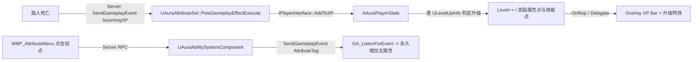

# Spec + TDD 01：技能蓝耗/冷却 与 经验升级加点系统

> **状态**：`[Draft — 待 Mode A 讨论定稿]`
> **所属阶段**：Phase 2 / M2.1 & M2.2
> **参考源码**：`DruidMech/GameplayAbilitySystem_Aura`（Cost & Cooldown、XP / Leveling Up、Attribute Points 章节）

---

## 1. 目标与边界（Goal & Non-Goals）

### 目标
1. **技能蓝耗与冷却**：让玩家技能具备真实的 Mana Cost 与 Cooldown 约束，并在 HUD 上实时反馈冷却倒计时。
2. **经验与升级**：击杀敌人结算 XP，达到阈值自动升级（支持一次获得大量经验连升多级），奖励 AttributePoints 与 SpellPoints，恢复血蓝并播发升级特效。
3. **属性加点**：在现有 `WBP_AttributeMenu` 上打通消耗属性点提升主属性（Strength / Intelligence / Resilience / Vigor）的完整多人同步闭环。

### 明确不做（Non-Goals）
- 本阶段暂不做技能树解锁/装备（归入 `02_Debuffs_And_Skills.md`）。
- 暂不做升级进度存档序列化（归入 P2）。

---

## 2. 玩法与交互流

---

## 3. C++ 与蓝图职责切分

| 层级 | 负责内容 |
| :--- | :--- |
| **C++** | `UWaitCooldownChange`、`ULevelUpInfo`、`IPlayerInterface`、`IncomingXP` Meta Attribute、`AAuraPlayerState` 复制字段与委托、`UAttributeMenuWidgetController` 加点入口与广播 |
| **Blueprint / Asset** | `GE_Cost_*`、`GE_Cooldown_*`、`DA_LevelUpInfo`、`GE_EventBasedEffect` / `GA_ListenForEvents`（或 C++ 直接应用 GE）、`WBP_XPBar` 与 `WBP_AttributeMenu` 按钮绑定、升级 Niagara 挂件 |

---

## 4. 核心数据结构与类接口（草案）

### 待新增 Native GameplayTags
- `Cooldown.Fire.FireBolt`（及后续技能对应 Cooldown Tag）
- `Attributes.Meta.IncomingXP`

### 待新增 / 扩展类
- **`UWaitCooldownChange`**（继承 `UBlueprintAsyncActionBase`）：监听 `ASC` 冷却 Tag 增减与 ActiveGE 剩余时间，广播 `CooldownStart` / `CooldownEnd`。
- **`ULevelUpInfo`**（`UDataAsset`）：`TArray<FAuraLevelUpInfo>`（`LevelUpRequirement`、`AttributePointAward`、`SpellPointAward`），提供 `FindLevelForXP(int32 XP)`。
- **`IPlayerInterface`**：解耦 `AttributeSet` / 技能与 `AAuraCharacter`（`AddToXP`、`GetXP`、`FindLevelForXP`、`AddToPlayerLevel`、`AddToAttributePoints`、`AddToSpellPoints`、`LevelUp` 等）。
- **`AAuraPlayerState`**：新增 `XP`、`AttributePoints`、`SpellPoints`（均带 `ReplicatedUsing` 与 `FOnPlayerStatChanged` 委托）。
- **`UAuraAttributeSet`**：新增 `IncomingXP` Meta Attribute + 升级后回满 `Health` / `Mana` 标志（`bTopOffHealth` / `bTopOffMana`，在 `PostAttributeChange` 中安全补满）。
- **`UCharacterClassInfo`**：`FCharacterClassDefaultInfo` 新增 `FScalableFloat XPReward`。

---

## 5. 多人同步方案（待细化确认）

- **权威端**：敌人死亡派发 `IncomingXP`、升级判定、扣除属性点与增加主属性均严格在服务端执行。
- **复制**：`Level`、`XP`、`AttributePoints`、`SpellPoints` 通过 `AAuraPlayerState::GetLifetimeReplicatedProps` 同步，客户端 `OnRep_*` 触发相同委托以驱动 `OverlayWidgetController` / `AttributeMenuWidgetController` 刷新 UI。
- **RPC**：
  - `UAuraAbilitySystemComponent::ServerUpgradeAttribute(const FGameplayTag& AttributeTag)`（校验 `AttributePoints > 0` 后扣点并修改属性）。
  - 升级特效（Niagara）通过 `AAuraCharacter::MulticastLevelUpParticles` 广播给所有端。

---

## 6. 验收标准（Acceptance Criteria）

- [ ] 蓝量不足或冷却中无法重复释放火球；HUD 冷却遮罩与实际 CD 同步（含客户端）
- [ ] 击杀不同职业敌人按 `XPReward` 曲线获得经验，XP 进度条正确更新
- [ ] 经验跨级（如一次升 2 级）能正确累加属性点/技能点、血蓝回满并播放升级特效
- [ ] 双端 PIE 下客户端打开属性菜单点击加点，主属性与派生次级属性（MaxHealth/Armor 等）正确重算并同步
- [ ] UBT 编译通过，无新增警告
