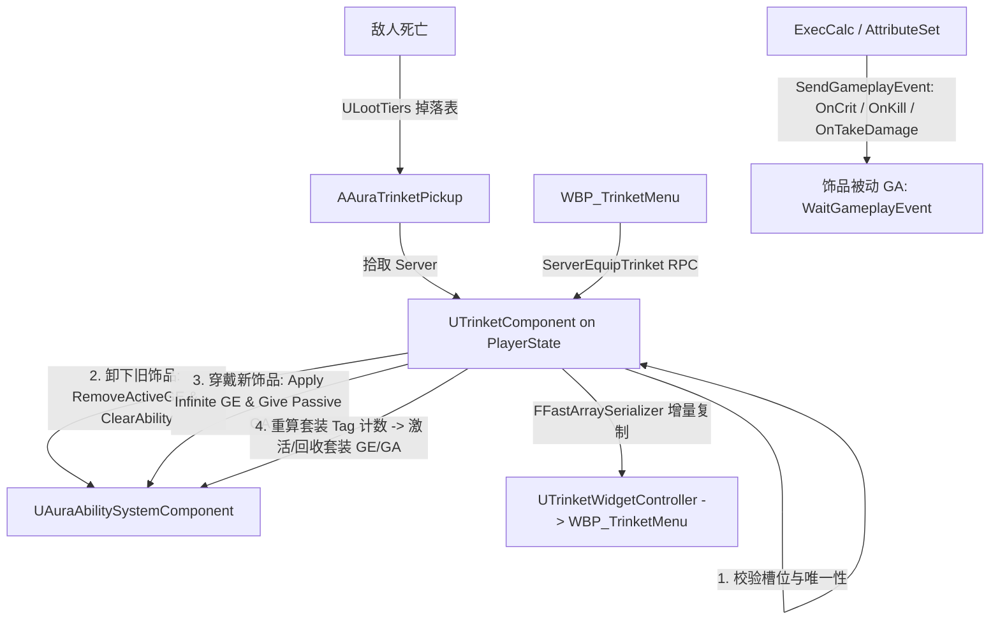

# Spec + TDD 03：自研 GAS 饰品系统（Trinket System）

> **状态**：`[Draft — 核心自研亮点，开工前逐项拍板]`
> **所属阶段**：Phase 4 / M4.1 ~ M4.4
> **定位**：Aura Demo 区别于纯教程项目的**核心架构名片**，融合原版“被动技能”与“掉落表”思想并升级为完整的 GAS 装备子系统。

---

## 1. 目标与边界（Goal & Non-Goals）

### 目标
1. 独立设计并实现一套**数据驱动、零硬编码耦合、多人同步友好**的饰品系统。
2. 展示对 GAS 底层生命周期的深度掌握：装备穿脱时精准管理 `FActiveGameplayEffectHandle` 与 `FGameplayAbilitySpecHandle`，杜绝属性残留或被动技能泄漏。
3. 展示事件驱动解耦：通过 `GameplayEvent` 让饰品被动 GA 响应战斗事件（暴击/击杀/受击），战斗核心代码无需知晓任何具体饰品存在。
4. 形成完整可玩闭环：**击杀敌人按掉落表掉饰品 -> 拾取入包 -> 打开饰品界面穿脱 -> 实时触发属性/被动/套装效果**。

### 明确不做（Non-Goals）
- 不做复杂网格背包/拖拽排序/交易行/分解强化。
- 饰品仅负责数值、被动能力与套装逻辑，不强求每个饰品都做独立挂点 3D 穿戴模型。

---

## 2. 待拍板设计决策（开工前逐条确认）

- [ ] **决策 1 — 槽位规划**：建议固定 3~4 个语义化槽位（如 `Trinket.Slot.Ring1`、`Trinket.Slot.Ring2`、`Trinket.Slot.Amulet`、`Trinket.Slot.Relic`），同类唯一性通过 `bUniqueEquip` 控制。
- [ ] **决策 2 — 组件归属**：`UTrinketComponent` 挂载在 `AAuraPlayerState`（推荐：与 `ASC` 同生命周期，角色死亡重生不丢装备）还是 `AAuraCharacter`？
- [ ] **决策 3 — 套装机制**：是否支持 2 件套 / 3 件套 Tag 计数自动激活套装 GE/GA（例如 `Trinket.Set.Pyromancer` 2 件套：火伤 +15%，3 件套：暴击触发火焰爆炸）？
- [ ] **决策 4 — 网络复制选型**：采用 `FFastArraySerializer`（面试亮点拉满，支持增量同步与单项 Add/Change/Remove 回调）还是普通 `TArray` + `ReplicatedUsing`？

---

## 3. 核心架构与数据流（草案）



---

## 4. 核心数据结构（草案）

### `UTrinketDataAsset`（`UPrimaryDataAsset`）
- `FGameplayTag TrinketId`（唯一标识，也用于网络传输与存档）
- `FText DisplayName` / `FText Description` / `TObjectPtr<UTexture2D> Icon`
- `ETrinketRarity Rarity`（Common / Rare / Epic / Legendary）
- `FGameplayTag SlotTag`（允许装备的槽位类型）
- `FGameplayTag SetTag`（所属套装，可为空）
- `bool bUniqueEquip = true`
- `TArray<TSubclassOf<UGameplayEffect>> GrantedEffects`（装备期间生效的 `Infinite GE`）
- `TArray<TSubclassOf<UGameplayAbility>> GrantedAbilities`（装备期间赋予的被动 `GameplayAbility`）
- `FGameplayTagContainer GrantedTags`

### 运行时实例句柄追踪（仅服务端维护）
```cpp
struct FEquippedTrinketHandles
{
    TArray<FActiveGameplayEffectHandle> ActiveEffectHandles;
    TArray<FGameplayAbilitySpecHandle> GrantedAbilityHandles;
};
```
> 卸下饰品或销毁组件时遍历 `FEquippedTrinketHandles`，调用 `ASC->RemoveActiveGameplayEffect(Handle)` 与 `ASC->ClearAbility(SpecHandle)`，确保 100% 干净回收。

---

## 5. 示例饰品设计（用于 Demo 实战演示，3~5 件即可讲透架构）

1. **静态数值型（验证 Infinite GE + MMC 重算）**：如 *活力护符*（`+10 Vigor`，验证 MaxHealth 自动联动提升与卸下回退）。
2. **暴击触发型（验证 `Event.Combat.OnCrit` + 被动 GA）**：如 *雷霆指环*（暴击时对目标周围敌人触发一次额外雷电伤害，带内置冷却防死循环）。
3. **击杀回复型（验证 `Event.Combat.OnKill` + 被动 GA）**：如 *噬魂吊坠*（击杀敌人回复 15% 最大法力值）。
4. **套装联动型（验证套装计数与动态激活/撤销）**：2 件同属 `Trinket.Set.Ember` 装备同时穿戴时，自动激活额外火焰增伤 GE，脱掉任意一件立即撤销。

---

## 6. 验收标准（Acceptance Criteria）

- [ ] 反复穿脱同一饰品 / 替换同槽位饰品 20 次后，属性数值精确还原，ASC 中无残留 `ActiveGE` 或重复 `AbilitySpec`
- [ ] 双端 PIE 下客户端操作穿脱饰品，服务端权威校验并同步，双方属性面板、被动触发与饰品 UI 完全一致
- [ ] 套装凑齐自动激活、拆散自动回收，支持多次切换不串台
- [ ] 击杀敌人可按配置掉落饰品，拾取后进入背包并可立即装备生效
