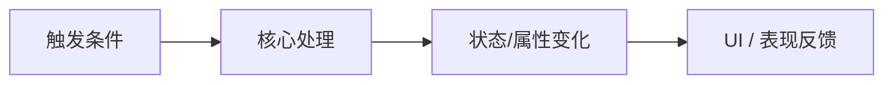

# Spec + TDD 模板：[模块名称]

> **状态**：`[Draft | In Review | Approved | Implemented]`
> **所属阶段**：Phase X / M X.X
> **参考源码（可选）**：`DruidMech/GameplayAbilitySystem_Aura` 对应章节或类

---

## 1. 目标与边界（Goal & Non-Goals）

### 目标（What we build）
- 解决什么玩法或架构问题？
- 希望在面试时通过该模块展示什么工程能力？

### 明确不做（Non-Goals — 防止范围蔓延）
- 例如：暂不做跨地图持久化、暂不做复杂美术动画表现。

---

## 2. 玩法与交互流（User Flow）

关键边界情况（Edge Cases）：
- 例如：连续快速点击、角色死亡瞬间触发、客户端网络延迟重复请求。

---

## 3. C++ 与蓝图职责切分

| 层级 | 负责内容 |
| :--- | :--- |
| **C++** | 数据结构、核心计算、GAS 逻辑、网络复制/RPC、WidgetController 绑定 |
| **Blueprint / Asset** | 具体数值配置（DataAsset / CurveTable / GE）、UMG 排版、Niagara/SFX 表现 |

---

## 4. 数据结构与类接口设计

### 新增 GameplayTags（Native / Config）
- `Tag.Category.Name` — 用途说明

### 新增或修改的 C++ 类 / 结构体
- `UExampleDataAsset`：字段列表
- `UExampleComponent`：核心公开方法与委托签名
- `UExampleWidgetController`：向 UI 暴露的委托与调用方法

---

## 5. 多人同步方案（Replication Plan）

- **权威端**：哪些数据与判断仅在服务端（`HasAuthority()`）执行？
- **RPC 列表**：
  - `UFUNCTION(Server, Reliable) void ServerDoSomething(...)` — 参数校验规则
  - `UFUNCTION(Client / NetMulticast, ...)` — 表现广播规则
- **属性 / 容器复制**：
  - `UPROPERTY(ReplicatedUsing=OnRep_...)` 或 `FFastArraySerializer`
  - 客户端 `OnRep` 后如何刷新本地 UI？

---

## 6. 验收标准（Acceptance Criteria）

- [ ] 单人 PIE 下核心功能跑通，无 Warning / Error 日志
- [ ] Listen Server + Client（2 Players PIE）下状态同步正确，客户端 UI 与服务端数据一致
- [ ] 关键异常边界（空指针、非法请求、反复开关/穿脱）无崩溃、无句柄/属性泄漏
- [ ] UE 5.8 UBT 编译 0 Error，相关文档（`01_Architecture.md` / `03_Progress_Log.md`）已同步更新
