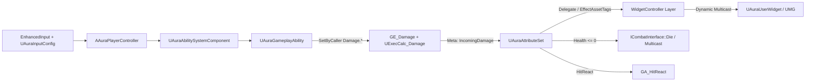

# Aura (UE 5.8 GAS Action RPG)

> 基于 **Unreal Engine 5.8** 与 **Gameplay Ability System (GAS)** 开发的俯视角动作 RPG 演示项目。
> 仓库地址：[https://github.com/lmllajsal090/Aura2](https://github.com/lmllajsal090/Aura2)

本项目以 Stephen Ulibarri 的 GAS RPG 框架（前 19 章）为底层基线，从 **第 20 章节点起转为自主架构设计与迭代**，核心目标是构建一个**多人同步友好（Listen Server）**、包含完整成长/战斗闭环与**自研 GAS 饰品系统**的工程化客户端作品。

---

## 核心技术栈与工程亮点

| 维度 | 当前实现 / 规划落点 |
| :--- | :--- |
| **引擎与语言** | Unreal Engine 5.8 / C++20 + Blueprints（严格区分底层逻辑与表现配置） |
| **网络同步架构** | Listen Server + Client 友好：玩家 `ASC/AS` 挂载于 `AAuraPlayerState`（`Mixed` 模式），敌人挂载于 `AAuraEnemy`（`Minimal` 模式），自定义 `FAuraGameplayEffectContext::NetSerialize` |
| **GAS 战斗管线** | `EnhancedInput` + Tag 驱动技能激活、`SetByCaller` 多元素伤害、`UExecCalc_Damage`（抗性/格挡/穿甲/护甲/暴击）、`Meta Attribute (IncomingDamage)` |
| **UI 解耦分层** | MVC / `WidgetController` 模式 + `TagsToAttributes` 自动化属性绑定，杜绝 UI 与战斗角色直接强耦合 |
| **AI 战斗体系** | `AAuraAIController` + `BehaviorTree`（近战/远程/召唤特化行为、自定义 `BTService` / `BTTask`、`MotionWarping` 转向） |
| **自研扩展亮点（开发中）** | **GAS 饰品系统（Trinket System）**：数据驱动 + `ActiveGE/SpecHandle` 生命周期回收 + `GameplayEvent` 零耦合被动触发 + `FFastArraySerializer` 同步 + 掉落闭环 |
| **AI 工程化协作** | 采用 Repo-First 渐进式文档体系（`AGENTS.md` + `Docs/Specs/` + ADR），支持多 Coding Agent 零漂移协作 |

---

## 核心架构数据流



---

## 文档导航（Documentation Index）

- **AI 协作入口**：[AGENTS.md](AGENTS.md)（架构红线、编译命令、默认 Mode A 协作协议）
- **当前架构快照**：[Docs/01_Architecture.md](Docs/01_Architecture.md)（完整属性、GameplayTag、网络拓扑与源码索引）
- **开发路线图**：[Docs/02_Roadmap.md](Docs/02_Roadmap.md)（第 20 章后的阶段里程碑与优先级取舍）
- **开发进度与决策日志（ADR）**：[Docs/03_Progress_Log.md](Docs/03_Progress_Log.md)
- **功能设计书（Spec + TDD）**：
  - [模板：Spec + TDD](Docs/Specs/_TEMPLATE.md)
  - [01 - 消耗/冷却与升级加点系统](Docs/Specs/01_Cost_Cooldown_Leveling.md)
  - [02 - Debuff、技能菜单与进阶技能](Docs/Specs/02_Debuffs_And_Skills.md)
  - [03 - 自研 GAS 饰品系统（核心亮点）](Docs/Specs/03_Trinket_System.md)
  - [04 - 主角与地图换皮技术契约](Docs/Specs/04_Reskin_Contract.md)

---

## 快速开始（Quick Start）

### 环境要求
- Unreal Engine **5.8**
- Visual Studio 2022（含 C++ 游戏开发工作负载）或 JetBrains Rider
- **Git LFS**（`*.uasset` 与 `*.umap` 均由 Git LFS 托管）

### 克隆与编译
```powershell
git lfs install
git clone https://github.com/lmllajsal090/Aura2.git
cd Aura2

# 命令行编译 Editor 目标（请按本机 UE 5.8 路径调整）
& "C:\Program Files\Epic Games\UE_5.8\Engine\Build\BatchFiles\Build.bat" AuraEditor Win64 Development -Project="$PWD\Aura.uproject" -WaitMutex -FromMsBuild
```

---

## 演示预览（Showcase）

> 待 Phase 5（饰品系统与换皮收口）完成后补充实战演示 GIF 与核心模块截图。

---

## 致谢与参考

- 底层 GAS 教学框架参考：[DruidMech/GameplayAbilitySystem_Aura](https://github.com/DruidMech/GameplayAbilitySystem_Aura)（本仓库在前 19 章基础上独立演进与扩展）
